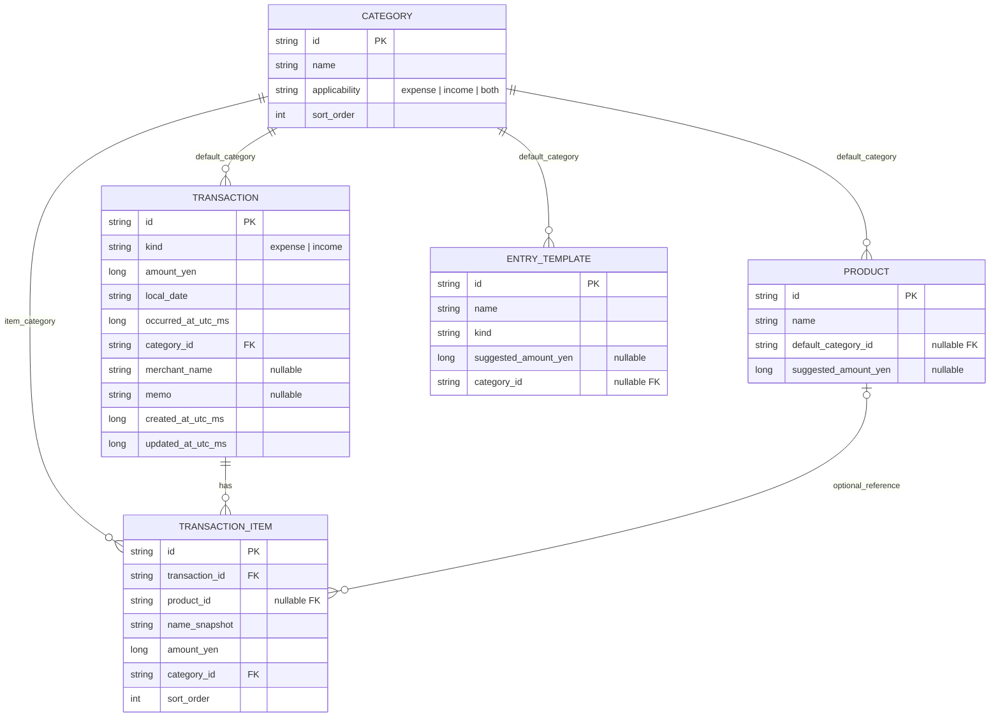

# アーキテクチャ設計 — meshi

- バージョン: 0.1 (draft)
- 対象: Android Native / 完全ローカルファースト / 公開ソース・GitHub Releases 配布
- 設計は **予定**。まだ実装・検証されたセキュリティ保証ではない。

## 1. 技術選定

| 関心 | 予定 |
| --- | --- |
| 言語 / UI | Kotlin / Jetpack Compose / Material 3 |
| UI 状態 | ViewModel + StateFlow / Coroutines |
| 永続化 | Room (SQLite) |
| DB 暗号化 | SQLCipher for Android を候補とし Room 統合を最初に検証 |
| 鍵保護 | Android Keystore |
| ロック | AndroidX BiometricPrompt と端末資格情報 |
| 設定 | DataStore（機密・鍵データは置かない） |
| バックアップ入出力 | Android Storage Access Framework |
| ビルド | Gradle Kotlin DSL |
| テスト | Kotlin/JUnit、Room migration test、Compose UI tests、端末統合試験 |
| CI / 配布 | GitHub Actions、署名済み APK、GitHub Releases |

minSdk、各ライブラリバージョン、暗号ライブラリの正確な API は実装開始時に互換性検証して固定する。

## 2. レイヤー構成

```text
Compose UI
  ↕ state/events
ViewModel (StateFlow)
  ↓
Use cases / Domain services (必要なものだけ)
  ↓
Repository contracts
  ↓
Room Repository implementations ── Room DAO ── SQLCipher SQLite
                                               ↑
                           Key manager ─ Android Keystore

Separate: EncryptedBackupService ←→ Repository/Database snapshot
Separate: AppLockManager ←→ BiometricPrompt
```

- UI はDBや暗号鍵に直接アクセスしない。
- ViewModel は入力と画面状態、業務操作を調整する。
- Repository はデータ操作の契約と、複数レコード更新のトランザクション境界を提供。
- Domain はAndroidフレームワークから極力独立させる。
- 単一 app モジュールから開始し、過剰なマルチモジュール化は避ける。
- 通貨計算に浮動小数点を使わず、整数円で扱う。

## 3. 論理データモデル



**注意:** これは概念スキーマ。Room エンティティ確定前に nullable 制約、索引、外部キー動作（削除時に過去データを壊さない）をテストで定義する。商品マスタとテンプレートは P1 の機能で、初期マイグレーションに必ず含める必要はない。

### 不変条件

1. Transaction.amountYen は正の整数。種別は expense / income を分離して保持。
2. 支出の詳細明細合計は取引合計以下。保存・編集は単一 DB トランザクションで検証。
3. 未入力額 = 取引合計 − 明細合計。未入力額は取引のカテゴリーに集計上割り当てるが、**明細レコードは自動生成しない**。
4. 月別総額には Transaction のみを足す。明細を足して二重計上しない。
5. カテゴリー別集計 = 明細ごとの分類額 + 未入力額の取引分類。合計が取引総額と一致。
6. 商品マスタの変更は既存の TransactionItem の nameSnapshot、amountYen、categoryId を変更しない。
7. カテゴリーの削除・統合は過去データの参照と集計値が壊れない手順で実施する（使用中カテゴリーの物理削除を原則禁止）。
8. 取引日付は独立した YYYY-MM-DD として保存し、月次集計の基準とする。絶対時刻はUTCで別保存。
9. 返金・振替・外貨・割引・税金の扱いは今後追加設計する。安易に支出額の負数を許可しない。
10. 複数テーブルにまたがる操作は成功かロールバックのどちらかとする。

## 4. Room とクエリ

- 初期インデックス候補: transaction(local_date), transaction(kind, local_date), transaction_item(transaction_id), transaction_item(product_id)。
- 外部キー制約を有効にし、Transaction 削除時の明細削除は意図的に定義する。
- 履歴はページングが必要になるまで単純クエリとし、ボトルネックを確認して最適化する。
- Room スキーマをリポジトリにエクスポートしてバージョン管理。
- **破壊的マイグレーションでユーザーデータを初期化しない**。
- マイグレーションテストでは旧バージョンのDBと実データ相当のサンプルを使う。
- 暗号化SQLCipherとRoomの組み合わせを、採用ライブラリの実際のバージョンでPOCし、DB再オープンとmigrationを検証する。

## 5. 脅威モデル・セキュリティ境界

### 守る資産

家計履歴、購入商品、店舗情報、メモ、暗号化バックアップ、DBの鍵、署名鍵。

### 想定する脅威

- 端末の紛失・一時的な第三者操作
- 誤って外部に露出したバックアップファイル
- OSバックアップ・端末移行による想定外のデータコピー
- ログ・例外・画面表示による漏洩
- 改ざん済みAPKや署名鍵漏洩
- データ破損・端末故障・鍵の無効化

### 範囲外

root/OSの完全侵害、ユーザーがロック解除済み端末を第三者に渡す行為、外部カメラでの撮影、悪意あるOSや物理サイドチャネルへの完全耐性。端末暗号化やサンドボックスだけで全脅威に耐えられるとは主張しない。

### 制御

- INTERNET 権限を **最終 Release merged manifest** に含めない。CIで検査（依存ライブラリの権限マージも含む）。
- 他の不要権限も避ける。SAFでユーザーが選択したファイルだけ読み書きする。
- Android Keystore に鍵暗号化用の鍵（KEK）を作り、ランダムなDB鍵（DEK）を包んで保存する方式を検討する。
- DB鍵を平文で永続化しない。メモリ上の鍵保持期間を短くし、ログに出さない。
- Keystore鍵の認証要否・有効期限・生体登録変更時の失効を定める。認証UIだけで強固な暗号学的アクセス制御が成立するとは仮定しない。
- BiometricPrompt によるロックは UI の保護。DB鍵の解放条件とアプリ再開時のタイムアウトを別途検証する。
- FLAG_SECURE は任意の追加防御とし、これだけで画面の漏洩を防げるとは考えない。
- Android のクラウド/デバイス転送は manifest と dataExtractionRules/backup_rules を OS別に設定してテストする。端末側でのバックアップ自動化を期待しない。
- 事故防止のため、実家計データをテストやCIに流さず、合成フィクスチャを用いる。

## 6. バックアップと復元

**Keystoreで暗号化したDBをそのままコピーするだけでは、端末故障時に鍵を復元できない。** 端末独立のバックアップ鍵設計が必要。

推奨方式:
1. ユーザー操作でバックアップを開始し、Storage Access Framework で保存先を選択。
2. 論理データをスキーマバージョン付きでスナップショット化し、必要なら中間のテンポラリファイルを暗号化または安全に扱う。
3. ランダム salt とメモリ負荷を持つ KDF（例: Argon2id、利用可能性とサポート環境を要確認）でユーザーパスフレーズからバックアップ鍵を導出。
4. ランダム nonce を使った AEAD（例: AES-256-GCM）で内容と形式識別子/バージョンなどのメタデータを認証付き暗号化。
5. ファイルには形式ID、バージョン、KDFパラメータ、salt、nonce、ciphertext/tag等を格納。独自暗号アルゴリズムは作らない。
6. 復元前にバージョン、形式、認証タグ、データ整合性を確認。失敗時は既存DBに触れない。
7. 復元は別の一時DBやトランザクション内で検証し、成功時のみ安全に置き換える。
8. 復元時の競合（既存データを置換するか、マージするか）はUIで明示する。初期版は **置換のみ** とし、明示確認と直前バックアップを促す。
9. 新端末に復元後は新しい端末KeystoreでDB鍵を再保護する。

パスフレーズ紛失時には復元できない設計となる。設計決定時にKDFパラメータとバックアップ互換性テストを定義する。

## 7. 配布とサプライチェーン

```text
main → CI lint/tests → tag vX.Y.Z
     → release job (protected environment / approval)
     → release build → signing → verify
     → APK + SHA256SUMS + notes → GitHub Releases
```

- 公開配布用は APK（AABではない）。ストアは使用しない。
- `applicationId` を固定し、`versionCode` は毎回増加させる。同一のアプリ署名証明書で署名する。
- 署名用キーストアとパスワードをGit履歴に一切入れない。
- リリース鍵をCIへ渡す場合は GitHub Actions の保護された environment secrets と承認ゲートを検討。より厳格な鍵保護が必要なら CI は unsigned APK まで、署名はローカルの保護された環境で実施する。
- `apksigner verify`、署名証明書の比較、APKの権限検査、SHA-256 checksum を自動化。
- PRや未信頼のコードに署名秘密鍵を渡さない。
- 旧APK→新APKの上書き更新でアプリデータが残ることを実機で確認する。署名鍵を失うと通常の更新ができなくなる。
- GitHub Releasesへの接続は利用者がブラウザで行う。アプリ自体にインターネット権限は不要。

## 8. テスト戦略

- Domain: 金額、日付、カテゴリー集計、部分明細、入力エラー、境界値、整数オーバーフロー。
- Database: CRUD、外部キー、トランザクション原子性、旧スキーマからのマイグレーション。
- Security: 暗号化DBを別のSQLiteビューアで直接開けないこと、鍵紛失時の挙動、ログに平文が出ないこと、ロック操作。
- Backup: 新端末相当での往復、誤パスフレーズ、改ざん、途中での書き込み失敗、古いフォーマット。
- UI: 最少操作で記録、画面回転、プロセス再生成、TalkBack・アクセシビリティ。
- Packaging: merged manifest にINTERNET権限なし、APK署名、バージョンコード、上書き更新のDB保持。
- すべて合成データでテストする。

## 9. 当面の実装順

1. Android Compose の最小プロジェクトを作成し、CIのlint/test/buildを通す。
2. Room + SQLCipher + Keystore の小規模技術検証。DB再起動と鍵の復元・無効化時の動作を確認。
3. 取引・カテゴリーの最小スキーマと集計テスト。
4. クイック入力、履歴、編集、月次集計を実装。
5. 認証ロック、暗号化バックアップ、復元とマイグレーションのテスト。
6. リリース署名・APK検証・GitHub Releasesの配布経路。
7. P1の明細・商品マスタ・テンプレート。

## 10. 未決定事項（実装前にADRを追加）

- Android minSdk とサポート端末
- Room/SQLCipherの確定した依存バージョンと統合方式
- 鍵の認証ポリシー、端末認証・生体変更・鍵無効化時のUX
- 暗号化バックアップの形式とKDFパラメータ
- Release key の運用（CI内署名 vs ローカル署名）
- トランザクションの返金・振替・複数通貨拡張方針

設計判断を変える場合は、なぜ変えたかと移行手段をADRなどに残す。
