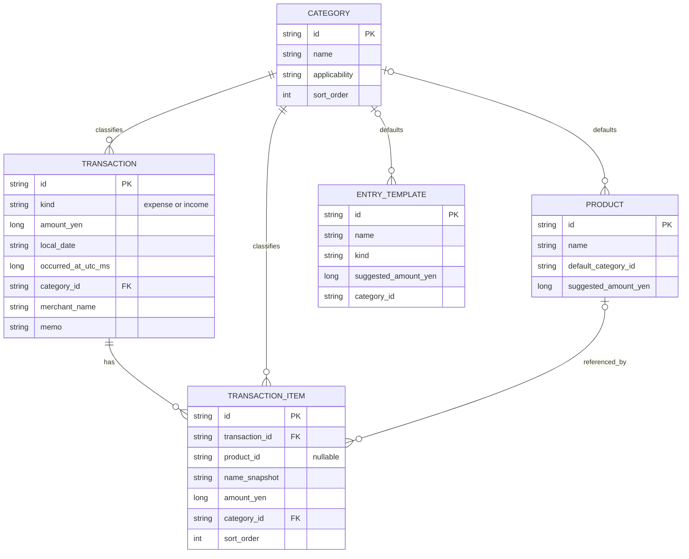

# アーキテクチャ

Version: 0.2

## Android構成

```text
Jetpack Compose
       |
ViewModel + StateFlow
       |
Domain / Repository interface
       |
Repository implementation
       |
Room DAO ── SQLite (SQLCipher)
                 |
       Android Keystore (鍵保護)

Backup / Restore ── Storage Access Framework
App Lock ── BiometricPrompt
```

- Kotlin + Jetpack Composeを使用する単一Androidアプリモジュールから開始。
- Repositoryが永続化処理とDBトランザクションを担当する。
- Domainで取引金額・明細整合性・集計処理を定義する。
- DataStoreにUI設定を保存する。
- Room + SQLCipherで取引を暗号化保存し、鍵解放・再起動・更新時の動作を自動テストする。

## データモデル



注: 商品マスタ・明細・テンプレートは段階的に実装する。エンティティは論理モデルであり、Roomの外部キー・nullable・削除時挙動は実装時に定義する。

## 金額と集計

```text
取引合計 = transaction.amountYen
明細合計 = SUM(transaction_item.amountYen)
残額     = 取引合計 - 明細合計

月別総額 = SUM(transaction.amountYen)
カテゴリー別額 = カテゴリーに属する明細額 + 取引カテゴリーの残額
```

- 支出の明細合計は取引合計以下で検証する。
- 残額は集計時に算出し、明細レコードとして自動作成しない。
- 商品マスタの変更を購入履歴へ反映させるのではなく、購入時スナップショットを表示する。
- 金額・日時・カテゴリーの編集はRepositoryが単一トランザクションで処理する。
- 取引日を月次集計のキーとする。

## データ保護

### DB

1. DB暗号鍵を乱数生成する。
2. Android Keystoreの鍵でDB暗号鍵を暗号化して保持する。
3. 認証・鍵解放時にSQLCipherへDB鍵を渡す。
4. 起動・ロック解除・鍵無効化・DB再オープンの挙動を統合テストする。

### バックアップ

1. 論理データをバージョン付き形式で書き出す。
2. ユーザーパスフレーズからKDFでバックアップ鍵を導出する。
3. 認証付き暗号（例: AES-GCM）で暗号化する。
4. Storage Access Frameworkで選んだファイルへ書き込む。
5. 復元時は形式・認証タグ・参照整合性を検証してから反映する。

バックアップの鍵は端末のKeystore鍵から独立させる。KDF・パラメータ・フォーマットを実装前に確定する。

### Android設定・検証

- Release APKのmerged manifestを検査する（通信権限、バックアップ・転送規則）。
- 生体認証と端末認証でのアプリロックを検証する。
- 機密情報がログ・クラッシュ出力に含まれないことを検査する。
- 使用する権限、暗号化フォーマット、鍵更新・復元手順をテストで固定する。

## 配布・CI

```text
GitHub Actions
  ├── lint / unit tests
  ├── build release APK
  ├── merged manifest validation
  ├── APK signing / verification
  └── GitHub Release: APK + SHA256SUMS
```

- リリース署名鍵は保護された環境で管理する。
- 配布方式はGitHub ReleasesからのAPK直接インストール。
- 旧版からの更新テストで署名の一致、versionCode、DBマイグレーションを確認する。

## 初期実装順

1. AndroidアプリのプロジェクトとCIを作成する
2. 取引・カテゴリーのRoomモデルと暗号化保存を実装する
3. クイック入力・履歴・編集・月次集計を動く画面として完成させる
4. アプリロック・バックアップ・復元と更新時のデータ保持を完成させる
5. 署名済みAPKをGitHub Releasesで配布し、実際の端末で継続利用する
6. 使用感に応じて明細・商品マスタ・入力テンプレートを追加する

## 実装前の決定事項

- minSdkと端末対応範囲
- Room/SQLCipherのバージョン・統合方式
- 認証タイムアウトとKeystoreの鍵有効化条件
- バックアップのファイル形式とKDF
- リリース署名の運用方式
